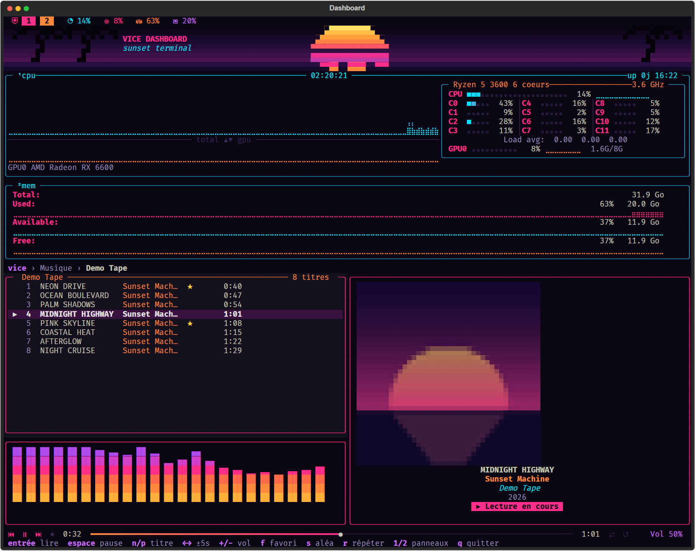

<div align="center">

# 🌴 Vice Dashboard

**Le moniteur système et le lecteur de musique de ton terminal, sous un coucher de soleil néon.**




</div>

## Ce que ça fait

Un seul écran, deux usages : surveiller le PC et écouter sa musique, sans quitter le terminal.

- **Bandeau animé** : soleil couchant à bandes, palmiers, reflet qui ondule sur la mer, ton nom en néon.
- **CPU** : graphe d'historique en braille, barre par cœur, fréquence, charge moyenne.
- **GPU** (Windows) : utilisation 3D et VRAM via les compteurs de performance, sans pilote ni outil en plus.
- **Mémoire** : utilisée, disponible, libre, chacune avec sa courbe.
- **Lecteur audio** : MP3, FLAC, WAV, OGG, M4A, avec pochette, titre, artiste, album et année lus dans les tags.
- **Spectre en temps réel** : vraie analyse FFT du morceau (MP3, FLAC, WAV, OGG), en dégradé coucher de soleil.
- **Favoris, aléatoire, répétition**, avance et retour de 5 secondes, volume.

## Installation

```bash
git clone https://github.com/lerapeurdu62280-debug/Vice-Dashboard.git
cd Vice-Dashboard
pip install -r requirements.txt
```

## Lancement

```bash
python vice_dashboard.py                          # lit le dossier Musique de l'utilisateur
python vice_dashboard.py "D:\Ma musique"          # un autre dossier (sous-dossiers compris)
python vice_dashboard.py --titre "MON PSEUDO" --sous-titre "night drive"
```

Prévois une fenêtre d'au moins **120 × 50** caractères, en plein écran c'est parfait.

## Touches

| Touche | Action | Touche | Action |
|---|---|---|---|
| `↑` `↓` | Naviguer dans la playlist | `f` | Ajouter ou retirer des favoris ★ |
| `Entrée` | Lire le titre | `s` | Lecture aléatoire |
| `Espace` | Pause / reprise | `r` | Répéter le titre |
| `n` / `p` | Titre suivant / précédent | `1` / `2` | Afficher / masquer CPU / mémoire |
| `←` / `→` | Reculer / avancer de 5 s | `q` | Quitter |
| `+` / `-` | Volume | | |

Les favoris sont gardés dans `~/.vice_dashboard_favoris.json`.

## Bon à savoir

- **Le terminal compte.** [Windows Terminal](https://aka.ms/terminal) donne le meilleur rendu. Si le terminal sait afficher des images (sixel, kitty), la pochette est nette ; sinon elle s'affiche en blocs de couleur, comme sur la capture.
- **Pas de couleurs ?** Vérifie que la variable d'environnement `NO_COLOR` n'est pas définie. Tu peux aussi forcer les couleurs avec `set TEXTUAL_COLOR_SYSTEM=truecolor`.
- **Températures** : Windows ne les fournit pas sans pilote tiers, elles ne sont donc pas affichées.
- **Spectre des M4A** : la librairie audio ne sait pas les décoder, le spectre est alors simulé.
- **Linux et macOS** : pensé pour Windows. Le monitoring CPU et mémoire et le lecteur devraient fonctionner, mais ce n'est pas testé, et le panneau GPU est propre à Windows.
- Au-delà de 300 morceaux, seuls les 300 premiers du dossier sont chargés.

## Crédits

Mise en page inspirée de [btop](https://github.com/aristocratos/btop). Construit avec [Textual](https://github.com/Textualize/textual), [psutil](https://github.com/giampaolo/psutil), [pygame](https://www.pygame.org), [mutagen](https://github.com/quodlibet/mutagen) et [textual-image](https://github.com/lnqs/textual-image). Les morceaux de la capture sont fictifs et générés pour la démo.

<div align="center">

Fait à Boulogne-sur-Mer par **S.O.S INFO LUDO** · Licence MIT

</div>
